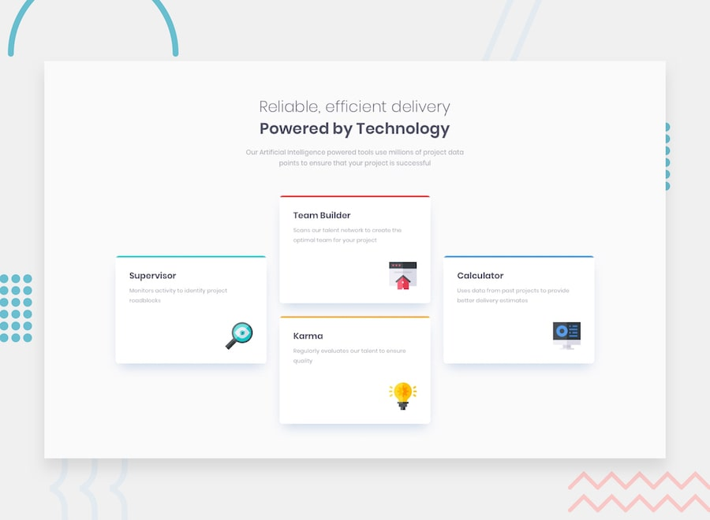

# Sección de cuatro tarjetas

Proyecto responsive inspirado en el reto Four Card Feature Section de Frontend Mentor. La página presenta una introducción y cuatro tarjetas con información e iconos.

## Mi experiencia

Lo que más me costó fue entender cómo pasar del diseño de escritorio a una cuadrícula con CSS Grid y Tailwind. Al principio me resultaba difícil decidir por qué las tarjetas necesitaban tres columnas y dos filas, y cómo colocar cada una en la posición correcta.

Tuve que practicar cómo hacer que Supervisor y Calculator ocuparan la altura de las dos filas, mientras Team Builder y Karma quedaban apiladas en la columna central. También me costó distinguir cuándo debía indicar una fila y cuándo una columna, y por qué las clases de posicionamiento tenían que aplicarse al `article` y no a su contenido.

Ir probando los cambios y compararlos con la referencia me ayudó a entender mejor el grid. Aunque me llevó tiempo, ahora comprendo mejor cómo organizar elementos con Tailwind y cómo hacer que el diseño cambie según el ancho de pantalla.

## Diseño responsive

- En móvil, las tarjetas aparecen en una sola columna.
- En escritorio, se distribuyen en tres columnas: una tarjeta a cada lado y dos apiladas en el centro.
- Las referencias del proyecto están en la carpeta [`design/`](./design/).

## Tecnologías

- HTML
- Tailwind CSS v4
- Fuente Poppins

## Ejecutar el proyecto

Instala las dependencias desde la carpeta raíz del proyecto:
`npm install`

- Para trabajar en local, inicia Tailwind en modo de observación:
  `npm run dev`
- Para generar el CSS de publicación minificado:
  `npm run build`

Ambos comandos generan `build.css`, que es la hoja de estilos enlazada en `index.html`. El comando de publicación lee `src/input.css`, donde están definidos los colores y el tema de Tailwind.
